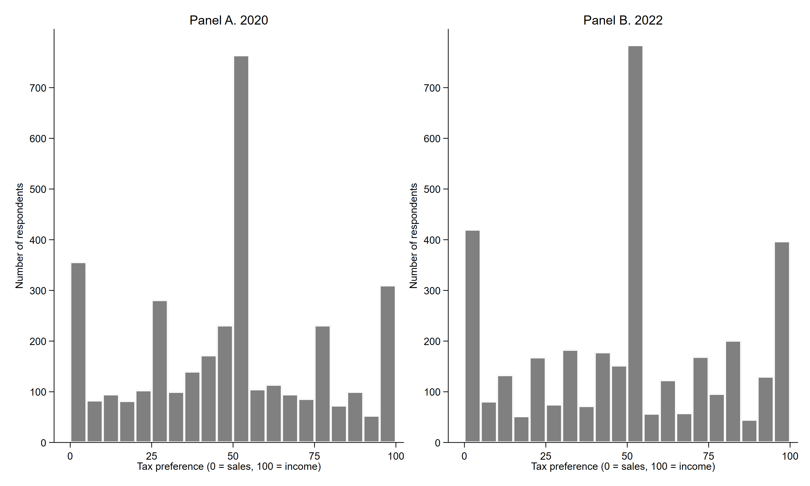

# Relative Income and Tax Progressivity Preferences

**Evidence from Local Comparisons**

Replication code and selected outputs for my 2026 M.A. thesis in Economics at
Hunter College, City University of New York.

[Read the thesis](UlrickMitton_Thesis.pdf) · [Browse the Stata code](code/) ·
[Review the generated tables](results/)

## Overview

This thesis studies whether the income composition of a respondent's local area
is associated with preferences over how governments raise tax revenue. It joins
2020 and 2022 Cooperative Election Study panel responses to ZIP-code income and
inequality estimates from the American Community Survey. The analytic sample
contains 3,574 respondents and 7,135 respondent-wave observations.

## Main findings

- Respondents in higher-income ZIP codes express greater support for income
  taxation relative to sales taxation, conditional on observed characteristics.
- Higher family income is consistently associated with less support for income
  taxation, while higher local inequality is associated with more support.
- The neighborhood-income association is evident in the pooled sample and in
  2020, but not in 2022.
- Piecewise models suggest that the relationship between relative income and tax
  preferences changes at the local median.

These are conditional associations from observational data and should not be
interpreted as causal neighborhood effects.

## Repository contents

- `UlrickMitton_Thesis.pdf`: final thesis, dated November 9, 2026.
- `code/`: active Stata data-preparation, analysis, and table-building scripts.
- `figures/`: selected generated figures in PDF and PNG formats.
- `results/`: generated LaTeX tables.
- `data/README.md`: data access and placement instructions. Respondent-level
  survey data are intentionally not distributed in this repository.

## Reproducing the analysis

The workflow was developed in Stata 18. Run all scripts from the repository root:

1. `code/ACS_ZIP_Prep_API.do`
2. `code/CES_ACS_Merge.do`
3. `code/Summary_Statistics.do`
4. `code/Run_Core_Regressions.do`
5. `code/Build_Tables.do`

`Build_Tables.do` and `Summary_Statistics.do` use the `estout` package. Install it
in Stata with `ssc install estout` if it is not already available. See
[`REPRODUCIBILITY.md`](REPRODUCIBILITY.md) and [`code/README.md`](code/README.md)
for details.

## Citation

> Mitton, Ulrick. 2026. *Relative Income and Tax Progressivity Preferences:
> Evidence from Local Comparisons*. M.A. thesis, Hunter College, City University
> of New York.

Machine-readable citation metadata are available in [`CITATION.cff`](CITATION.cff).

## Rights

The Stata code is available under the MIT License. The thesis manuscript and
research outputs remain copyright © 2026 Ulrick Mitton. See [`LICENSE.md`](LICENSE.md)
for the full scope and third-party-data notice.
